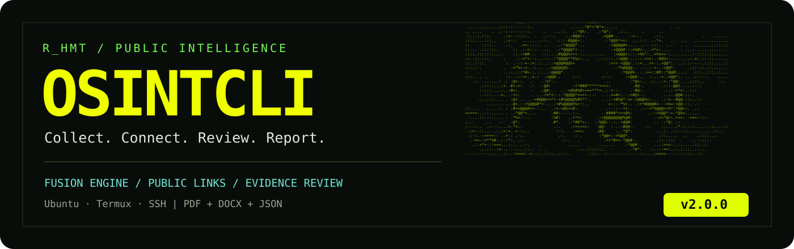
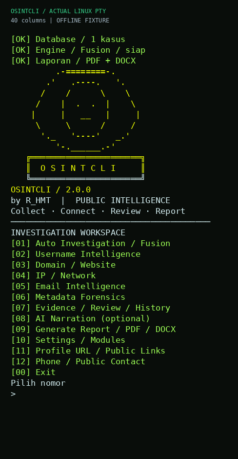
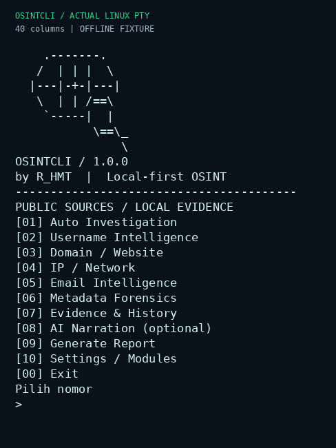

<div align="center">



[](CHANGELOG.md)
[](pyproject.toml)
[](LICENSE)
[](#mulai)

**Workspace investigasi sumber publik, langsung dari terminal.**

Username / URL → metadata → tautan publik → review → PDF atau DOCX.

[Mulai](#mulai) · [Kemampuan](#kemampuan) · [Contoh penggunaan](#contoh-penggunaan) · [Pengujian](docs/TEST-V2.md) · [Batasan](docs/LIMITATIONS.md)

</div>

## Apa yang baru?

**Fusion** membaca profil publik, mengikuti tautan yang memang dicantumkan, dan menyimpan asal setiap hubungan. Anda bisa menerima, menolak, atau menunda hubungan dengan catatan. Bukti asli tetap tersimpan bersama waktu pengambilan dan hash.

Tampilan baru memakai banner ASCII, warna kuning–hijau–cyan, animasi startup singkat, dan menu bernomor. ASCII asli ada di `osintcli/assets/banner-original.txt`; terminal sempit memakai versi ringkas agar gambar tidak pecah. Animasi bisa dimatikan.

Laporan **PDF dan DOCX** berisi ringkasan, metadata per profil, hubungan, catatan review, sumber, dan kegagalan pengumpulan. JSON/CSV/HTML/PNG tetap tersedia. Semua data kasus disimpan lokal di SQLite.

<p align="center">
  
</p>

<details>
<summary>Lihat rekaman alur menu → evidence → export</summary>



Rekaman berasal dari interaksi PTY Linux, bukan rekaman perangkat Android. Data demonstrasi diberi label **OFFLINE FIXTURE**. Hasil pengujian sumber nyata dibahas terpisah dalam [TEST-V2](docs/TEST-V2.md).

</details>

## Mulai

### Ubuntu / VPS

```bash
sudo apt-get update
sudo apt-get install -y python3 python3-venv git

git clone https://github.com/rahmat-369/OsintCLI.git
cd OsintCLI
bash install.sh
bash start.sh
```

Python **3.11 atau lebih baru** diperlukan. `start.sh` membuka menu. Installer memasang aplikasi dan dependensi laporan di virtual environment sendiri.

### Termux langsung di Android

```bash
pkg update
pkg install python git

git clone https://github.com/rahmat-369/OsintCLI.git
cd OsintCLI
bash scripts/install-termux.sh
osintcli
```

Untuk menyimpan laporan ke Download Android, jalankan `termux-setup-storage` sekali dan izinkan akses. Modul native tertentu mungkin memerlukan kompilasi; Fusion bawaan tidak membutuhkan `curl_cffi`. Pengujian perangkat Termux fisik belum dilakukan.

**Jika Termux dipakai untuk SSH ke VPS:** jalankan panduan Ubuntu di sesi SSH. Aplikasi dan laporan berada di VPS; izin storage Android hanya diperlukan pada sesi Termux lokal untuk mengunduh laporan.

### Update instalasi lama

```bash
cd ~/OsintCLI
git pull --ff-only
bash install.sh
bash start.sh
```

Database versi 1 dimigrasikan otomatis; sebelum migrasi, salinan `osintcli.db.v1.backup` dibuat di folder data. Kasus lama tetap dapat dibuka. Untuk instalasi core tanpa dependensi laporan: `bash install.sh --core-only`.

## Kemampuan

| Masukan / modul | Hasil yang benar-benar dikumpulkan |
| --- | --- |
| Username / Fusion | Metadata profil GitHub, GitLab, Instagram, TikTok, Reddit **jika sumber publik dapat dibaca** |
| URL profil | Profil tertentu, metadata, dan tautan publik keluar |
| Website / link hub | Judul, deskripsi, tautan profil sosial, kontak publik, `rel=me`; hub yang dikenal dapat meneruskan tautan keluar |
| Domain | DNS, RDAP, certificate transparency; HTTP/TLS bila dipilih |
| IP publik | Registrasi jaringan dan ASN; bukan lokasi orang |
| Email | Sintaks dan konfigurasi DNS mail; bukan pembuktian mailbox atau akun sosial |
| Nomor telepon | Normalisasi format internasional; kontak `wa.me`/`tel:` yang ditemui dari halaman disimpan sebagai hubungan publik |
| File lokal | Hash dan metadata gambar, PDF, OOXML; ExifTool opsional |
| Evidence / review | Sumber, waktu, hash, hubungan, riwayat keputusan, resume |
| Ekspor | PDF, DOCX, JSON, CSV, HTML, PNG |
| AI opsional | Narasi dari subset bukti dengan persetujuan pengiriman dan review; laporan tetap bekerja tanpa AI |

**Nomor WhatsApp saja tidak mengungkap akun Instagram/TikTok, nama, lokasi, atau kamera.** Kesamaan username lintas situs juga tidak membuktikan satu pemilik. Laporan menunjukkan apa yang diamati dan apa yang belum bisa disimpulkan.

### Mode Fusion

| Mode | Situs awal untuk username | Kedalaman tautan |
| --- | --- | --- |
| `quick` | GitHub, GitLab | 0 — hanya catat tautan |
| `standard` | GitHub, GitLab, Instagram, TikTok, Reddit | 1 |
| `deep` | Situs yang sama | 2 |

Default maksimal **12 halaman**, dapat diatur 1–30. URL berulang tidak dikunjungi ulang; tautan dengan query, media, kontak, dan host internal tidak diikuti otomatis. Tautan baru tidak memicu pencarian massal semua variasi username. Mode deep menambah penelusuran tautan, bukan melewati akun privat atau login.

## Repo sumber terbuka yang digunakan

| Proyek | Peran di OsintCLI | Cara integrasi |
| --- | --- | --- |
| [User Scanner](https://github.com/kaifcodec/user-scanner) | Dasar ekstraksi metadata publik Instagram/TikTok; engine alternatif GitHub/TikTok | Parser publik diadaptasi dengan kredit MIT; CLI opsional pada commit yang dipin |
| [Sherlock](https://github.com/sherlock-project/sherlock) | Pembanding kandidat username GitHub/GitLab/Reddit | Proses terpisah; CSV dinormalisasi ke evidence |
| [Maigret](https://github.com/soxoj/maigret) | Engine pembanding username | Proses terpisah; scope situs dipilih, tanpa rekursi upstream |
| [ExifTool](https://github.com/exiftool/exiftool) | Metadata file lokal lebih luas | Proses lokal, hasil JSON dinormalisasi |

Fusion bawaan, Sherlock, Maigret, dan User Scanner dipilih **satu engine per scan username** untuk menghindari permintaan duplikat. Penggabungan ada pada format bukti, review, riwayat kasus, dan laporan. Seluruh ribuan modul upstream tidak otomatis diaktifkan.

```bash
# Opsional: jalankan dari folder repo, pasang yang diperlukan saja.
bash scripts/install-tools.sh user-scanner
bash scripts/install-tools.sh sherlock
bash scripts/install-tools.sh maigret

# Ubuntu: ExifTool dari package manager
sudo apt-get install libimage-exiftool-perl
```

User Scanner eksternal memerlukan dependensi native `curl_cffi`; gunakan Fusion bawaan bila pemasangannya tidak tersedia pada arsitektur Termux. Versi/commit dan dependensi tercatat saat pemasangan. Lihat [THIRD_PARTY_NOTICES](THIRD_PARTY_NOTICES.md).

## Contoh penggunaan

Semua contoh CLI berikut dijalankan dari folder repo. Untuk menu interaktif cukup `bash start.sh`.

```bash
# Preview scope tanpa mengirim permintaan.
bash start.sh scan octocat --mode standard

# Jalankan setelah scope sesuai.
bash start.sh scan octocat --mode standard --max-nodes 12 --yes

# Mulai dari satu profil, lalu ikuti tautan publik maksimal dua tingkat.
bash start.sh scan https://github.com/octocat --kind profile --mode deep --yes

# Modul lama tetap tersedia.
bash start.sh scan example.com --kind domain --yes
bash start.sh scan 1.1.1.1 --kind ip --yes
bash start.sh scan foto.jpg --kind metadata --yes

# Engine alternatif, setelah dipasang.
bash start.sh scan octocat --kind username --modules user-scanner --yes
```

Output scan menampilkan `CASE_ID=...`. Gunakan ID tersebut pada perintah berikut:

```bash
bash start.sh history
bash start.sh show CASE_ID
bash start.sh graph CASE_ID

# Penerimaan adalah keputusan operator; wajib menuliskan alasannya.
bash start.sh evidence-review CASE_ID EVIDENCE_ID accepted --note "Tautan terlihat pada bio sumber"

bash start.sh report CASE_ID --formats pdf,docx,json --out ./hasil
bash start.sh resume CASE_ID --yes
```

Di menu **[07]**, pilih kasus → **[4] hubungan** atau **[5] review**. Di menu **[09]**, pilih format dan lokasi. Enter atau `lokal` memakai folder laporan bawaan; `android` memakai Download Android; masukan lain diperlakukan sebagai path.

### Mengambil laporan VPS ke HP

Salin path absolut yang ditampilkan setelah export. Buka sesi **Termux lokal**, kemudian:

```bash
termux-setup-storage
scp -P PORT_SSH USER@HOST:/path/laporan.pdf ~/storage/downloads/
```

Ganti `PORT_SSH`, `USER`, `HOST`, dan path sesuai VPS Anda. Untuk Word, unduh file `.docx` dengan cara yang sama.

## Arti hasil

| Status | Arti |
| --- | --- |
| `VERIFIED` | Observasi cocok dengan sumber yang dibaca; bukan verifikasi identitas orang |
| `CANDIDATE` | Profil atau hubungan yang perlu ditinjau |
| `UNVERIFIED` | Informasi terbatas, hasil negatif, atau batas pengumpulan |
| `FAILED_SOURCE` | Sumber gagal, diblokir, atau formatnya tidak dikenali |
| Kasus `PARTIAL` | Sebagian sumber gagal; bukti yang berhasil tetap dapat diekspor |

Review `accepted`, `rejected`, dan `pending` disimpan terpisah dari status sumber. Riwayat review tidak menghapus bukti asli. Narasi AI yang lama perlu ditinjau ulang setelah dataset/review berubah.

## Pengaturan dan pengujian

```bash
bash start.sh doctor
bash start.sh config animation off
bash start.sh config fusion_mode standard
bash start.sh config fusion_max_nodes 12

# Pengujian regresi lokal setelah dependensi reports dipasang.
python3 -m unittest discover -s tests -v

# Pengujian sumber nyata; membutuhkan jaringan.
python3 scripts/verify-fusion.py --out output/live-v2
```

Animasi juga dapat dilewati dengan Ctrl+C saat startup atau `OSINTCLI_NO_ANIMATION=1`. `NO_COLOR=1` menonaktifkan warna. Output noninteraktif tidak dianimasikan.

Default jaringan memakai koneksi langsung dengan validasi alamat publik. Bila lingkungan memang mewajibkan proxy, baca [PROXY.md](docs/PROXY.md); mode proxy membatasi hostname yang diizinkan. Situs yang tidak dapat dijangkau tetap ditulis sebagai kegagalan, bukan diabaikan.

Rincian tes aktual dan kegagalan sumber: **[TEST-V2.md](docs/TEST-V2.md)**. Exit code scan `0` berarti modul selesai, `2` berarti hasil parsial/gagal, `130` untuk pembatalan sebelum selesai; selalu baca status kasus dan sumber. Modul nomor hanya memvalidasi format.

## Dokumentasi

[Arsitektur](docs/ARCHITECTURE.md) · [Laporan](docs/REPORT-SPEC.md) · [AI](docs/AI.md) · [Batasan](docs/LIMITATIONS.md) · [Keamanan](SECURITY.md) · [Changelog](CHANGELOG.md)

Dikembangkan oleh **[R_HMT](https://github.com/rahmat-369)** · [rhmt.biz.id](https://rhmt.biz.id)

Lisensi MIT untuk OsintCLI. Lisensi, atribusi, dan batas integrasi proyek upstream tersedia di [THIRD_PARTY_NOTICES.md](THIRD_PARTY_NOTICES.md).
